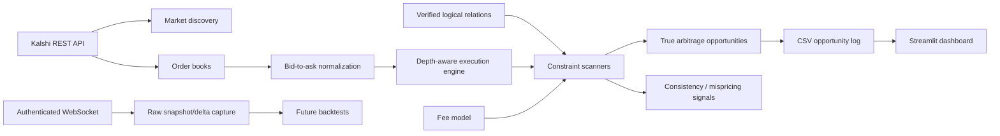

[README.md](https://github.com/user-attachments/files/34864100/README.md)
# Event Market Arbitrage

A research-grade, read-only **Kalshi event-market mispricing and arbitrage scanner** built for quantitative-finance recruiting.

The project consumes live order books, reconstructs executable asks from Kalshi's bid-only binary books, walks real depth, applies fee-aware execution logic, distinguishes **true arbitrage** from **relative-value inconsistency**, logs opportunities, and supports prospective WebSocket data collection for later backtesting.

> **Scope:** research and paper trading. There is intentionally **no order-placement code** in this repository.

## Why this project exists

Prediction markets quote probabilities, but economically related contracts must obey logical constraints. Examples:

- A binary market's YES and NO payoffs are complementary.
- If outcomes are mutually exclusive **and exhaustive**, exactly one YES contract settles at $1.
- If event A implies event B, then `P(A) <= P(B)`.

The interesting engineering problem is not finding a suspicious displayed price. It is asking whether a violation remains after:

1. converting the book into **executable** prices,
2. walking available depth,
3. charging transaction fees,
4. enforcing settlement logic, and
5. refusing to call a relationship risk-free unless its rules have been verified.

## Current features

### 1. Binary complement scanner

For one market, buys YES and NO at executable asks and checks whether the combined settlement value of $1 exceeds total execution cost plus fees.

### 2. Exhaustive-basket scanner

For a user-verified exactly-one-outcome basket:

- **Underpriced basket:** buy YES on every outcome. Exactly one contract pays $1.
- **Overpriced basket:** buy NO on every outcome. Exactly `n-1` contracts pay $1.

The engine requires `exhaustive: true` in the relation file. Merely being mutually exclusive is not enough.

### 3. Logical implication scanner

For a verified relationship `A => B`, the portfolio

```text
Buy NO(A) + Buy YES(B)
```

pays at least $1 in every logically possible state. The engine checks whether the executable cost plus fees is below that guaranteed payout.

### 4. Consistency signals

Some probability-ordering violations are interesting but not tradeable after spread and fees. These are reported separately as **signals**, not arbitrage.

### 5. Depth-aware execution

The scanner walks every order-book level rather than assuming unlimited liquidity at the best quote. It evaluates candidate sizes at depth breakpoints and chooses the size with the highest theoretical net profit.

### 6. Fee-aware economics

The default general event-contract taker fee model is parameterized as:

```text
fee = round_up(rate * contracts * price * (1 - price))
```

with a default rate of `0.07` and cent rounding. Fee schedules can differ by market, so the configuration supports per-ticker taker-rate overrides rather than hard-coding one schedule into strategy logic. Multi-level sweeps use a conservative per-level rounded fee estimate.

### 7. Fixed-point / sub-cent support

Money is represented with Python `Decimal`. Current Kalshi REST order books use:

```text
orderbook_fp.yes_dollars
orderbook_fp.no_dollars
```

Both arrays contain **bids**. A YES ask is derived from the opposite NO bid:

```text
YES ask = 1 - NO bid
NO ask  = 1 - YES bid
```

### 8. Optional WebSocket collector

An authenticated read-only collector records order-book snapshots and deltas to JSONL for prospective microstructure research and queue-aware backtesting. It does not place orders.

### 9. Streamlit dashboard

Logged opportunities can be inspected in a simple recruiting/demo dashboard with net edge, theoretical P&L, size, and time-series views.

---

## Architecture



## Repository structure

```text
event-market-arbitrage/
├── README.md
├── pyproject.toml
├── config.example.yaml
├── relations.example.yaml
├── dashboard.py
├── docs/
│   └── INTERVIEW_GUIDE.md
├── scripts/
│   └── demo.py
├── src/event_arb/
│   ├── models.py
│   ├── config.py
│   ├── storage.py
│   ├── paper.py
│   ├── cli.py
│   ├── kalshi/
│   │   ├── client.py
│   │   ├── orderbook.py
│   │   └── ws.py
│   └── arbitrage/
│       ├── fees.py
│       ├── relations.py
│       └── scanners.py
├── tests/
├── data/
└── results/
```

## Installation

```bash
python -m venv .venv
```

macOS/Linux:

```bash
source .venv/bin/activate
```

Windows PowerShell:

```powershell
.venv\Scripts\Activate.ps1
```

Install:

```bash
pip install -e ".[dev]"
```

Copy the example configuration:

```bash
cp config.example.yaml config.yaml
cp relations.example.yaml relations.yaml
```

## Quick demo without live data

```bash
python scripts/demo.py
```

The demo constructs synthetic order books containing known logical arbitrage and runs them through the same production scanner.

## Scan live public Kalshi order books

```bash
event-arb scan --config config.yaml --relations relations.yaml --limit 500
```

Add `--save-snapshots` to persist REST snapshots:

```bash
event-arb scan --config config.yaml --relations relations.yaml --limit 500 --save-snapshots
```

### Relation configuration

The scanner deliberately does **not** infer risk-free relationships from titles alone.

Example:

```yaml
baskets:
  - name: Fed decision outcomes
    tickers:
      - TICKER-A
      - TICKER-B
      - TICKER-C
    exhaustive: true
    verified_rules_note: "Exactly one outcome resolves YES under identical settlement rules."

implications:
  - name: Temperature threshold nesting
    antecedent: TEMP-GT90
    consequent: TEMP-GT85
    verified_rules_note: "Same city, date, source and measurement definition."
```

This is intentional. Contract rules matter more than similar-looking titles.

## WebSocket collection

Create `.env` in the directory where you run the collector, or export:

```text
KALSHI_API_KEY_ID=...
KALSHI_PRIVATE_KEY_PATH=/absolute/path/to/private-key.pem
```

The collector loads this `.env` automatically. Existing environment variables take
precedence over values in the file. Keep credentials and private keys out of Git.

Then:

```bash
event-arb collect MARKET-TICKER-1 MARKET-TICKER-2 --config config.yaml --output data/live_books.jsonl
```

The collector signs the WebSocket handshake with RSA-PSS and records inbound messages plus local receive timestamps.

## Dashboard

After running scans:

```bash
streamlit run dashboard.py
```

## Tests

```bash
pytest -q
```

Tests cover:

- fixed-point order-book parsing,
- bid/ask reciprocity,
- depth walking,
- fee rounding,
- complement arbitrage,
- exhaustive-basket safety checks,
- implication arbitrage, and
- relation-file parsing.

## Research design

### Arbitrage vs. mispricing

The repository uses the terms carefully:

**Arbitrage** requires a portfolio whose minimum settlement payoff exceeds its executable acquisition cost plus modeled fees.

**Mispricing / consistency signal** means prices violate an economic or probability relationship, but a guaranteed positive P&L is not established.

This distinction prevents midpoint comparisons, stale quotes, and non-exhaustive outcome sets from being reported as free money.

### Execution assumptions

The REST scanner is a **snapshot backtest / opportunity detector**, not a latency-arbitrage execution model. A detected opportunity can disappear before simultaneous legs are filled.

For that reason, results are best interpreted as:

```text
"Executable from the observed snapshot under atomic-fill assumptions"
```

rather than as realized P&L.

A stronger future version would model:

- legging risk,
- queue position,
- message latency,
- partial fills,
- stale snapshot probability,
- per-market fee overrides,
- settlement delays, and
- capital lock-up.

### Historical L2 limitation

Queue-accurate historical order-book reconstruction requires data to be collected prospectively. Candlesticks and trades cannot recreate the complete historical L2 book. The included WebSocket recorder exists to build that dataset over time.

## Recruiting talking points

This project demonstrates:

- market microstructure,
- event-contract payoff replication,
- no-arbitrage logic,
- fixed-point financial arithmetic,
- API ingestion,
- L2 order-book normalization,
- transaction-cost modeling,
- liquidity-aware sizing,
- WebSocket streaming,
- configuration-driven research design,
- testing and reproducibility, and
- separation of research signals from executable trades.

A concise resume bullet after collecting real results could become:

> Built a Python event-market relative-value engine that ingests live Kalshi L2 books, detects logical pricing violations across binary and multi-outcome contracts, and filters opportunities for transaction fees and executable depth; captured WebSocket snapshots/deltas for prospective microstructure backtesting.

Do **not** add performance numbers to a resume until they come from logged, reproducible results.

## Data/API notes

The implementation targets the Kalshi Trade API v2 structure current in 2026:

- REST base: `https://external-api.kalshi.com/trade-api/v2`
- WebSocket: `wss://external-api-ws.kalshi.com/trade-api/ws/v2`
- Fixed-point order book: `orderbook_fp`
- Bid arrays: `yes_dollars`, `no_dollars`

Relevant documentation:

- https://docs.kalshi.com/
- https://docs.kalshi.com/llms.txt
- https://help.kalshi.com/en/articles/13823805-fees

API schemas and fee schedules can change. Validate the current Kalshi documentation before relying on this project for any live decision.

## Safety / disclaimer

This software is for educational, research, and paper-trading purposes. It is not financial advice and does not guarantee execution or profit. Event contracts can involve legal, regulatory, settlement, liquidity, and operational risks. Read each market's rules and current fee schedule independently.
